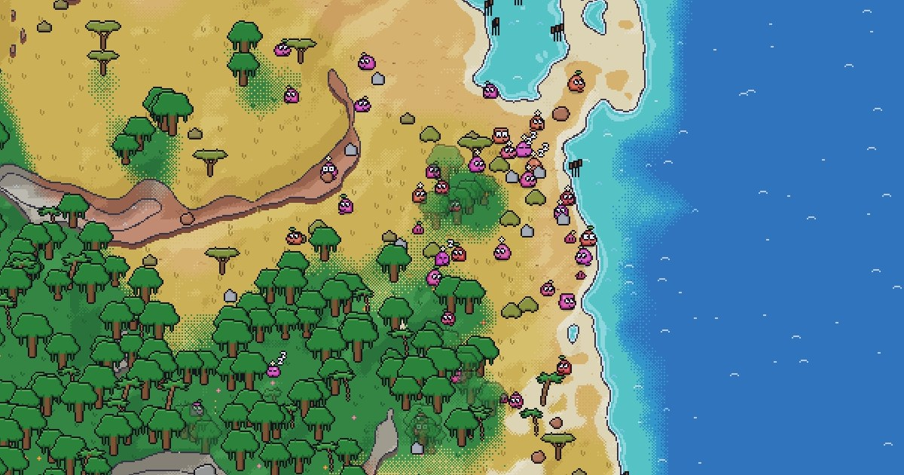

# Wigglewood

**[Open the island](https://fordpepper.github.io/wigglewood/)**



A tiny island ecosystem that never stops. Dumplings eat berries, grumbles eat
dumplings, and both have babies that inherit their parents' genes (size, speed,
sight, colour, hats) with small mutations, so the island slowly evolves.

**Everyone sees the same world.** The state of the island is a pure function of
the current time: open it on two devices at once and the same creatures are in
the same places. No accounts, no server, just GitHub.

## How it works

- `site/sim/core.js` is a deterministic simulation. It only uses arithmetic that
  IEEE-754 pins down exactly (`+ - * /`, `sqrt`, integer ops), its own seeded RNG
  and its own sine, so Node and every browser compute bit-identical results.
  One tick is 250 ms of real time, counted from the world's founding (`EPOCH_MS`).
- Every 15 minutes a GitHub Action (`.github/workflows/world.yml`) loads the last
  checkpoint from the `state` branch, simulates up to the latest 30-minute
  boundary, saves the new checkpoint and publishes the site to GitHub Pages.
- Your browser downloads that checkpoint and simulates the remaining minutes
  itself, then keeps running in real time. State is round-tripped through JSON at
  every checkpoint, so a browser that started from an older checkpoint follows
  exactly the same path as the Action.
- Day and night follow the viewer's own clock (that part is only drawn, not
  simulated, so the shared world is the same in every timezone). Seasons belong
  to the island: each one lasts three real hours.

## Running locally

```sh
node scripts/advance.mjs none site/state   # build a checkpoint for "now"
cd site && python3 -m http.server 8000     # then open http://localhost:8000
```

Other tools:

```sh
node scripts/test-determinism.mjs          # continuous vs. reloaded runs must match
node scripts/balance.mjs 48                # simulate 48 hours headless, print populations
```

`?season=0..3&hour=0..24` in the URL previews a season or time of day (drawing
only; the world itself is unaffected).

## Changing the rules

Any change to `site/sim/core.js` changes the world's future and makes old
checkpoints incompatible. Bump `SIM_VERSION` when you do: the Action will then
rebuild the world from its founding moment.

Font: [Comic Neue](https://github.com/crozynski/comicneue) (SIL Open Font License).
